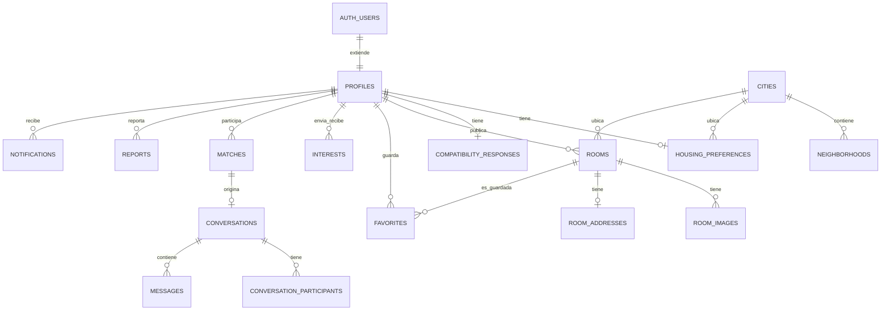

# Base de datos — ROOMLY

PostgreSQL (Supabase). UUID como PK en todas las tablas. `created_at`/`updated_at`
donde aplica. Soft delete (`deleted_at`) en `profiles` y `rooms` — el resto se
borra en duro o se conserva sin restricción (ver "Soft delete vs. GDPR" abajo).

El SQL real vive en `supabase/migrations/` (el esquema, las políticas RLS, las
correcciones de la auditoría inicial y las migraciones incrementales de las
Fases 2, 3 y 4) y `supabase/seed.sql`. Este documento explica las decisiones; el código fuente
de la verdad es el SQL.

## Revisión crítica (lo que se encontró y se corrigió)

Este esquema pasó por una segunda pasada adversarial antes de darlo por bueno.
Esto es lo que cambió:

### Sobreingeniería eliminada

| Se quita | Por qué estaba de más |
|---|---|
| Tabla `verifications` (email/universidad/identidad/vivienda) | El MVP solo verifica email (sección 18 del brief: "No implementar KYC complejo en el MVP"). Email verificado ya lo da gratis `auth.users.email_confirmed_at` de Supabase. Construir una tabla extensible para 3 tipos de verificación que no tienen ningún flujo detrás es infraestructura para una función que no existe todavía. Se añade en V2/V3 cuando haya un proveedor de KYC real que la necesite. |
| Tabla `notification_preferences` con JSONB granular | El MVP tiene 5 tipos de notificación. Preferencias por tipo con UI propia es una funcionalidad de configuración real que nadie pidió construir todavía. Una columna `profiles.email_notifications_enabled boolean` cubre la sección 21 ("no enviar spam, crear preferencias") sin construir un sistema de preferencias granular sin usuarios que lo reclamen. |

### Riesgos de seguridad corregidos

| Riesgo | Corrección |
|---|---|
| `profiles` era legible por cualquiera, incluso sin sesión — nombre, bio, fecha de nacimiento de cada usuario quedaban rascables por bots anónimos. | El SELECT completo ahora exige `auth.uid() is not null`. Para que las páginas SEO públicas (`/barcelona/habitaciones`) sigan siendo rastreables por Google sin sesión, se añadió la vista `public_profile_previews` (solo id, nombre, avatar, rol) con permiso explícito para `anon`. **Actualización (Fase 2.9, H4)**: ya no basta con tener sesión; cada usuario lee solo su perfil (ver "Fase 2.9 — H4"). **Actualización (hotfix `20261014120000`, 2026-10-31)**: con los privilegios por defecto de Supabase, anon y authenticated tenían también INSERT, UPDATE y DELETE sobre la vista, y por ella se escribía en `profiles` sin RLS. Desde el hotfix, PUBLIC, anon y authenticated no tienen ningún privilegio sobre ella (ver "Hotfix: `public_profile_previews` sin privilegios de clientes"). |
| Nada impedía que un usuario (o un bot) enviara cientos de "me interesa" por minuto — vector de spam/acoso. | Trigger `enforce_interest_rate_limit` en `interests`: tope de 30 por usuario cada 24h a nivel de base de datos, como backstop además del check "amigable" que hará la UI. |
| Sin una regla explícita, alguien podría añadir sin querer una política de INSERT en `matches` o `conversation_participants` y permitir que un cliente se "auto-matchee" o se cuele en una conversación ajena. | Se documenta explícitamente en el SQL que la ausencia de política de INSERT en `matches`/`conversations`/`conversation_participants` es intencional: esas filas solo las crea el servidor tras verificar interés mutuo. |
| La dirección exacta de una habitación vivía en la misma tabla que el resto de campos públicos — un `SELECT *` mal escrito en cualquier punto del código la habría filtrado. | Se movió a `room_addresses`, tabla propia con su propia política RLS (solo el propietario). Es el único campo de todo el esquema cuya fuga tiene una consecuencia física (localizar dónde vive alguien), así que es el único que se protege a nivel de base de datos y no solo "acordándose" de proyectar las columnas correctas en el código. |

### Riesgos de escalabilidad abordados

- **Matching a 100.000 usuarios**: el candidato a puntuar nunca es "todos los usuarios". Antes de calcular ningún score, se filtra por índices (`city_id`, fechas solapadas, rango de presupuesto) — eso acota el conjunto a decenas o cientos de perfiles como mucho, incluso a gran escala. El cálculo de compatibilidad (caro, en TypeScript) solo corre sobre ese conjunto ya acotado. Si en el futuro esto no basta, el siguiente paso natural es precalcular/cachear matches en un job en background — la capa de servicios ya está diseñada para que ese cambio no toque la API pública (ver ARCHITECTURE.md).
- **Condición de carrera al crear un match**: dos interstore simultáneos (A→B y B→A casi a la vez) pueden disparar dos intentos de crear el mismo match. El constraint `unique (user_a_id, user_b_id)` lo hace seguro: el segundo intento falla por duplicado, y la app debe tratar ese error como "ya existe" (`ON CONFLICT DO NOTHING` o equivalente), no como un fallo real.
- **N+1 en listados** (habitaciones con fotos, matches con perfil+preferencias+test): la capa de servicios debe usar los `select` anidados de Supabase/PostgREST o joins explícitos, nunca un fetch por fila dentro de un bucle. Se deja como regla explícita en `CLAUDE.md`.

### Lo que se revisó y se decidió mantener (no es sobreingeniería)

- **`room_addresses` como tabla separada**: sobrevive la revisión porque protege el único campo con consecuencia de seguridad física, no por "arquitectura elegante".
- **`admin_action_logs`**: una sola tabla append-only, sin lógica compleja. El panel admin puede bloquear personas y resolver reportes — sin trazabilidad de eso, no hay manera de auditar un abuso del propio panel. Coste bajo, valor de confianza alto.
- **18 tablas en total**: el número en sí no es el riesgo — cada una responde a una sección explícita del brief (habitaciones, interés, chat, reportes, admin). El riesgo real era construir infraestructura sin función detrás (lo que sí se cortó arriba), no el conteo de tablas.

### Mapeo con los nombres de tabla pedidos

Se ha pedido explícitamente un esquema para `users`, `preferences` y
`verification_status` con esos nombres literales. Mantengo la decisión
de la revisión anterior sobre las tres, pero la dejo explícita aquí para
que la confirmes o la corrijas directamente:

| Nombre pedido | Qué hay en su lugar | Por qué |
|---|---|---|
| `users` | `auth.users` (gestionada por Supabase) + `profiles` (FK 1:1 a `auth.users.id`) | `auth.users` ya guarda credenciales, email y proveedores OAuth. Una tabla `users` propia sería una copia que se puede desincronizar. En la práctica sigue existiendo "un registro de usuario" — la mitad la gestiona Supabase Auth y la mitad `profiles`. |
| `preferences` | `housing_preferences` | Mismo concepto, nombre más específico (conviven con preferencias de notificación, respuestas del test...). Todas las columnas pedidas — presupuesto, fechas, zona, número de compañeros — están ahí. |
| `verification_status` | No existe como tabla. `auth.users.email_confirmed_at` cubre la única verificación real del MVP. | El resto de badges (universidad, identidad, vivienda) no tienen ningún flujo funcional detrás todavía — el propio brief dice "no KYC complejo en el MVP" (sección 18). |

Si prefieres los tres nombres tal cual se pidieron, es un cambio pequeño
en el SQL (crear `verifications` con `user_id`/`type`/`status`/`verified_at`
es cosa de diez minutos) — no hay nada técnicamente forzoso en esta
elección, es una opinión de diseño que se puede anular sin fricción.
Dímelo y lo ajusto antes de Fase 1.

## Comprobación de coherencia final (antes de Fase 1)

Auditoría punto por punto contra `ARCHITECTURE.md`, `SECURITY.md`,
`ROADMAP.md` y el SQL, pedida explícitamente antes de confirmar el
esquema. 5 problemas reales encontrados, los 5 ya corregidos en el SQL
(no solo documentados aquí):

| # | Problema encontrado | Corrección |
|---|---|---|
| 1 | `rooms` no tenía columnas propias para "mascotas", "fumadores" ni "estudiantes" — tres filtros que la sección 13 del brief pide explícitamente. Solo existían, si acaso, como texto libre dentro de `features`, no fiable para filtrar. | Añadidas `pets_allowed`, `smoking_allowed`, `students_only` (boolean, `not null default false`) |
| 2 | Sin índice GIN en `rooms.features`, el filtro por "características" habría hecho un escaneo completo de la tabla a partir de cierto volumen. | Añadido `idx_rooms_features` |
| 3 | `conversation_participants` no tenía índice por `user_id` — el PK `(conversation_id, user_id)` no sirve para la consulta más frecuente del chat: "mis conversaciones". | Añadido `idx_conversation_participants_user` |
| 4 | Sin índice en `favorites.room_id`, contar cuántas veces se guardó una habitación (métrica de admin) habría sido lento a escala. | Añadido `idx_favorites_room` |
| 5 | **Escalado de privilegios real**: `profiles_update_own` y `participants_update_own` usaban `using` sin `with check`. RLS filtra filas, no columnas — nada impedía `update profiles set role = 'admin' where id = auth.uid()`, ni que un usuario "saltara" a cualquier conversación cambiando `conversation_id` en su propia fila de `conversation_participants`. | Restricción de columnas actualizables vía `GRANT`/`REVOKE` (detalle en `docs/SECURITY.md` y en el propio SQL): `authenticated` ya no tiene privilegio de `UPDATE` sobre `profiles.role` ni `conversation_participants.conversation_id`. También se reforzó el `INSERT` de `admin_action_logs`, que antes permitía a un admin atribuir una acción a otro admin. |

Ninguno de estos 5 cambios añade tablas, cambia nombres ni introduce
funcionalidad nueva — son índices y restricciones sobre el esquema ya
confirmado. El punto 5 es el único crítico: sin él, cualquier usuario
podía auto-promocionarse a admin.

## Correcciones de la auditoría inicial (2026-09-26)

La corrección del punto 5 de arriba resultó incompleta, y aparecieron
otros problemas al aplicar por primera vez el SQL en un PostgreSQL real.
Todo se corrige en `supabase/migrations/20260926120000_security_fixes.sql`
(migración nueva; las dos anteriores no se tocan) y cada punto tiene test
de regresión en `tests/db/`. Detalle y razonamiento en `docs/SECURITY.md`
§"Correcciones de la auditoría inicial".

- `profiles`: `INSERT` restringido por columnas (sin `role`/`deleted_at`)
  + `with check (role = 'user')`. Cerraba la auto-promoción a admin vía
  `INSERT`, que el punto 5 no cubría.
- Chat: nueva función `public.is_conversation_participant(uuid)`
  (`SECURITY DEFINER`, `search_path` vacío, sin parámetro de usuario). Las
  políticas de `messages`, `conversations` y `conversation_participants`
  la usan en vez de subconsultas: elimina la recursión infinita y una
  referencia ambigua a `conversation_id` que daba acceso a todas las
  conversaciones.
- `rooms`: trigger `trg_rooms_moderation` — solo un admin (o el servidor)
  cambia el estado desde o hacia `removed`.
- `reports`: `INSERT` restringido por columnas; quien reporta no puede
  fijar `status`, `resolved_by`, `resolved_at` ni `resolution_notes`.

Siguen siendo 18 tablas y 35 políticas (8 redefinidas). Se añaden 2
funciones (`is_conversation_participant`, `enforce_room_moderation`) y
1 trigger (`trg_rooms_moderation`).

## Fase 2.0 — endurecimiento de datos (2026-09-29)

Migración `supabase/migrations/20260929120000_phase2_data_hardening.sql`
(nueva; las anteriores no se tocan). Motivo: M4, porque una escritura
directa vía PostgREST se salta Zod y la base de datos es la última
barrera. No relaja ninguna política.

| Tabla | Constraint | Regla |
|---|---|---|
| `profiles` | `chk_profiles_full_name` | `btrim(full_name)` entre 1 y 100 caracteres |
| `profiles` | `chk_profiles_bio_length` | `bio` nula o ≤ 500 caracteres |
| `profiles` | `chk_profiles_avatar_url` | `avatar_url` nula, o `https://…` de ≤ 2048 caracteres (impide `javascript:`/`data:` en una columna que escribe el propio usuario) |
| `housing_preferences` | `chk_housing_preferences_field_of_study` | nulo, o `btrim` entre 1 y 120 caracteres |
| `housing_preferences` | `chk_housing_preferences_budget_max_nonneg` | `budget_max` ≥ 0. Junto con los ya existentes `chk_budget_positive` (`budget_min` ≥ 0) y `chk_budget_range` (`budget_min` ≤ `budget_max`) |
| `housing_preferences` | `chk_housing_preferences_roommates` | mínimo y máximo ≥ 0, y mínimo ≤ máximo |

**Sin techos, a propósito**: presupuesto, número de compañeros y número de
barrios preferidos no tienen máximo. Se valoraron topes (se propusieron y
se descartaron el 2026-09-29) porque la especificación no define ninguno.
Cualquier límite futuro tiene que ser una decisión explícita de producto,
no un valor técnico. El array de barrios sigue siendo `uuid[]` `NOT NULL`
y admite estar vacío.

Sin cambios: `seeking_status` ya es un enum; `date_of_birth` ya tiene
`chk_min_age`; `city_id` y `university_id` ya son FKs (una ciudad o
universidad inexistente se rechaza con `23503`).

Permisos de `housing_preferences` (detalle en `docs/SECURITY.md`): GRANT
por columnas, `profile_id` fuera del UPDATE y `anon` sin ningún privilegio.
Como en `profiles` (PR8), `upsert()` no sirve para esta tabla: los
servicios de Fase 2 harán INSERT y UPDATE por separado.

**Integridad de `preferred_neighborhood_ids`: triggers en las dos
direcciones** (decisión del usuario; se descartó la tabla intermedia para
no cambiar el esquema). Por qué no un CHECK ni una FK: comprobado en
PostgreSQL 16, un CHECK no admite subconsultas (`cannot use subquery in
check constraint`) y no existen FKs sobre elementos de un array (`uuid[]`
frente a `uuid`). Un CHECK que llamara a una función declarada `immutable`
con una consulta dentro sería una constraint falsa (Postgres no la
revalida) y se descartó.

- `trg_housing_preferences_neighborhoods` (`BEFORE INSERT OR UPDATE OF
  city_id, preferred_neighborhood_ids` en `housing_preferences`):
  - array vacío (el default; la columna es `NOT NULL`) → se acepta;
  - barrios con `city_id` nulo → `23514`;
  - algún UUID inexistente o `NULL` dentro del array → `23503`;
  - algún barrio de otra ciudad → `23514`. Cubre también cambiar
    `city_id` dejando barrios de la ciudad anterior.
- `trg_neighborhoods_not_referenced` (`BEFORE DELETE OR UPDATE OF id,
  city_id` en `neighborhoods`): si alguna preferencia usa el barrio,
  borrarlo, cambiarle el `id` o moverlo de ciudad falla con `23503`
  (`neighborhood_in_use`). **Sin cascadas**: quien administra decide qué
  hacer con esas preferencias antes. Renombrarlo sí se permite. También
  bloquea borrar una ciudad con barrios en uso (su borrado en cascada de
  barrios dispara el trigger).

Limitación conocida: no hay bloqueo entre las dos comprobaciones, así que
una escritura de preferencias y un borrado de barrio simultáneos podrían
cruzarse. Se acepta: solo un admin borra barrios, es raro, y la siguiente
escritura de esa fila la vuelve a validar. La comprobación inversa recorre
`housing_preferences` sin índice sobre el array; si crece, se añade un
índice GIN.

## Fase 2.3 — integridad del onboarding (2026-09-30)

Migración `supabase/migrations/20260930120000_phase2_onboarding_integrity.sql`
(nueva; no toca RLS ni GRANT). Decisiones del usuario:

- **`profiles.seeking_status` sin DEFAULT** (sigue `NOT NULL`). Antes, una
  fila creada sin enviarlo quedaba con `'flexible'`, indistinguible de una
  elección real. Ahora todo INSERT tiene que enviarlo (`23502` si falta), así
  que cualquier valor guardado fue enviado explícitamente. Sin datos que
  migrar. Consecuencia: los INSERT de perfiles de tests y fixtures envían
  `seeking_status`, y `profiles.Insert` lo exige en `types/database.ts`.
- **`trg_profiles_onboarding_completion`** (`BEFORE INSERT OR UPDATE OF
  onboarding_completed_at` en `profiles`): si el valor pasa a no nulo, exige
  una fila de `housing_preferences` del mismo perfil con `city_id`; si no,
  `23514` (`onboarding_incomplete:`). Poner la columna a `NULL` o no tocarla
  no se comprueba. **Actualización (Fase 2.9)**: desde `20261004120000`, una
  vez no nulo el valor ya no cambia, tampoco a `NULL` (ver "Fase 2.9"
  abajo). En un INSERT con valor no nulo siempre falla (las
  preferencias exigen que el perfil exista antes).
  - Es una defensa de integridad: la operación normal y la regla completa
    siguen en `completeOnboarding` (`lib/services/profile.ts`). El GRANT de
    `authenticated` incluye la columna, así que sin el trigger una escritura
    directa podía marcar como completo un onboarding sin ciudad.
  - `SECURITY INVOKER`: solo lee la fila de preferencias del propio perfil,
    que su dueño puede leer por RLS (`housing_preferences_own` no consulta
    `profiles`: no hay recursión). Quien no puede leer esas preferencias
    (p. ej. un admin editando el perfil de otro desde el cliente) no puede
    marcarlo completo; el servidor con `service_role` no tiene RLS.
  - No protege la dirección contraria: borrar las preferencias o vaciar
    `city_id` después de completar sigue siendo posible para el propio
    usuario (riesgo aceptado, ver PROGRESS.md sesión 12).

Siguen siendo 18 tablas y 35 políticas; se añaden 1 función
(`enforce_onboarding_completion`) y 1 trigger.

Coherencia universidad ↔ ciudad de `housing_preferences`: a diferencia de
los barrios (trigger de 2.0), no la impone la base de datos. La comprueba
`checkUniversityCity` en `lib/services/housing-preferences.ts` antes de
escribir (una universidad con `city_id` nulo vale con cualquier ciudad).
Pasarla a un trigger sería una decisión aparte, no tomada. **Actualización
(Fase 2.5)**: desde `20260930140000` también la impone la base de datos (ver
"Fase 2.5" abajo).

## Cuentas eliminadas: escrituras bloqueadas (2026-09-30)

Migración `supabase/migrations/20260930130000_block_deleted_account_writes.sql`
(nueva; no edita ninguna anterior). Cierra la decisión B de la auditoría de
2.3: `deleted_at IS NOT NULL` significa cuenta desactivada, y la base de
datos (no solo la aplicación) le impide escribir.

- `profiles_update_own` se recrea con `profiles.deleted_at is null` en
  `USING` y `WITH CHECK`.
- `housing_preferences_own` (`FOR ALL`) se sustituye por
  `housing_preferences_select_own` (misma condición que antes: lectura sin
  cambios) y `housing_preferences_{insert,update,delete}_own`, que añaden
  `exists (select 1 from public.profiles p where p.id = profile_id and
  p.deleted_at is null)`.

Sin cambios de tablas, columnas, GRANT, funciones ni triggers. Pasan a ser
18 tablas y **38 políticas** (−1 +4). El trigger de onboarding de 2.3 lee
`housing_preferences` con la política de SELECT, que no cambia. Detalle y
razonamiento en `docs/SECURITY.md`.

## Fase 2.5 — integridad de las preferencias (2026-09-30)

Migración `supabase/migrations/20260930140000_phase2_preferences_integrity.sql`
(nueva; no edita ninguna anterior). Resuelve el riesgo C de la auditoría de
2.3 y lleva a la base de datos la regla universidad ↔ ciudad.

| Regla | Mecanismo | Alcance |
|---|---|---|
| Con `onboarding_completed_at` no nulo, `housing_preferences.city_id` no puede ser `NULL` | `trg_housing_preferences_city_required` (`BEFORE INSERT OR UPDATE OF city_id`) → `23514` `housing_city_required:` | todos los roles, también `service_role`: es un invariante de los datos |
| Con el onboarding completado, el cliente no borra sus preferencias | `housing_preferences_delete_own` (RLS) exige además `p.onboarding_completed_at is null` → el DELETE afecta a 0 filas | solo `authenticated`; `service_role` y la cascada del perfil no se ven afectados |
| Una universidad con ciudad solo vale con esa ciudad | `trg_housing_preferences_university` (`BEFORE INSERT OR UPDATE OF city_id, university_id`) → `23514` `housing_university:` | todos los roles; universidad sin ciudad vale con cualquiera; universidad o ciudad inexistentes las rechaza su FK (`23503`) |

**Por qué RLS para el DELETE y no un trigger ni un `REVOKE`**: un trigger
`BEFORE DELETE` también bloquearía el borrado en cascada de un perfil
(`on delete cascade`, el futuro borrado de cuenta con `service_role`), y
revocar DELETE a `authenticated` quitaría también el borrado antes del
onboarding, que es inofensivo y ya estaba probado (`08`, `DA4`). La
política solo restringe al cliente. Consecuencia aceptada: el servidor
puede dejar a un perfil completado sin fila de preferencias (p. ej. al
borrar la cuenta); si luego el cliente la recrea, el trigger exige ciudad.

**Por qué trigger para la ciudad**: la regla depende de otra tabla
(`profiles`) y tiene que aplicar también al INSERT de una fila nueva;
un `WITH CHECK` de RLS daría un `42501` genérico y no cubriría al servidor.
El trigger da un error propio (`housing_city_required:`) que el servicio
traduce a un error de campo.

Ambas funciones son `SECURITY INVOKER`, con `search_path` vacío y `EXECUTE`
revocado; solo leen la fila del propio perfil y `universities`/`cities`
(lectura pública). Sin recursión. Siguen 18 tablas y **38 políticas** (se
recrea una). El fixture `HP-barrios` de `tests/db/05` que dejaba
`city_id = null` con una universidad de Barcelona ahora también vacía
`university_id`: ese estado ya lo rechazaba la aplicación desde 2.3 y ahora
también la base de datos; lo que prueba el test (barrios vacíos sin ciudad)
no cambia.

`cities.is_active` (rollout ciudad a ciudad) se comprueba en la aplicación,
no en la base de datos: una ciudad **nueva** tiene que estar activa, pero
una ya guardada que después se desactiva se puede conservar
(`checkPreferenceRules`). `universities` y `neighborhoods` no tienen
`is_active`.

**No existen en `housing_preferences`**: mascotas, tabaco y "solo
estudiantes" (`pets_allowed`, `smoking_allowed`, `students_only`) son
columnas de `rooms` (Fase 4). No se añaden como preferencias en 2.5:
sería un cambio de esquema pendiente de decisión.

## Fase 2.9 — `onboarding_completed_at` de una sola escritura (2026-10-04)

Punto A de la auditoría de 2.3. La 2.9 es una subfase nueva, definida por
el propietario el 2026-10-04 (ver `docs/ROADMAP.md`). H4 (privacidad de
`profiles`) es la segunda parte de la 2.9: ver la sección siguiente.

Migración `supabase/migrations/20261004120000_onboarding_write_once.sql`:
incremental; no modifica migraciones históricas ni toca RLS, GRANT,
columnas ni triggers. Solo redefine con `create or replace` la función
`public.enforce_onboarding_completion()` del trigger existente
`trg_profiles_onboarding_completion` (`BEFORE INSERT OR UPDATE OF
onboarding_completed_at`, de `20260930120000`), que ya se dispara
exactamente cuando una escritura toca la columna.

| Escritura sobre `onboarding_completed_at` ya no nulo | Resultado |
|---|---|
| timestamp → `NULL` | rechazada: `23514` `onboarding_locked:` |
| timestamp → otro timestamp | rechazada: `23514` `onboarding_locked:` |
| el mismo timestamp | permitida (con la comprobación de preferencias con ciudad de siempre) |
| no tocar la columna (editar otros campos) | permitida; el trigger no se dispara |

- **Para todos los roles** (decisión D1): `authenticated`, admin
  (`profiles_admin_all`), `service_role` y el dueño de las tablas. Un
  trigger se aplica aunque el rol no tenga RLS. **No hay bypass
  administrativo**: reiniciar un onboarding sería una decisión explícita
  nueva.
- El bloqueo se evalúa antes del `return` que deja pasar los `NULL`, así que
  volver a `NULL` no lo esquiva, tampoco tras borrar las preferencias.
- `completeOnboarding` (`lib/services/profile.ts`) no cambia: ya escribe
  solo `WHERE onboarding_completed_at IS NULL`.
- La función sigue siendo `SECURITY INVOKER`, con `search_path` vacío y
  `EXECUTE` revocado a `PUBLIC`, `anon` y `authenticated` (se repite el
  `revoke`).
- Consecuencia: queda cerrado el camino de volver a `NULL` para después
  borrar las preferencias o quitarles la ciudad, que la 2.5 prohíbe con el
  onboarding completo.
- Siguen siendo 18 tablas, 38 políticas (37 desde H4, abajo), 12 triggers y
  10 funciones.
- Validado también en Supabase real (`roomly-validation-2b`) en los runs 13
  y 15 de la 2.8: OB5b y OB11–OB14 en verde.

**Límites conocidos** (fuera del alcance del punto A):
- Borrar el perfil y volver a crearlo reinicia en la práctica el
  onboarding. Solo pueden borrar un perfil un admin (`profiles_admin_all`) o
  `service_role`; `authenticated` no tiene política de DELETE propia.
- Un superusuario puede desactivar el trigger; eso queda fuera del alcance.
- El mock de E1 (`tests/e2e/support/mock-supabase.mjs`) no emula este
  bloqueo: la aplicación nunca reinicia un onboarding, así que el
  comportamiento de E1 no cambia.

## Fase 2.9 — H4: privacidad de `profiles` (2026-10-04)

Segunda parte de la 2.9 (decisión D2, opción H4-1 del propietario).
Migración incremental
`supabase/migrations/20261004120100_profiles_privacy.sql`: solo
`drop policy "profiles_select_authenticated"`. No modifica migraciones
históricas, ni INSERT, UPDATE, DELETE ni GRANT, y no añade tablas,
columnas ni políticas. Pasan de **38 a 37 políticas** en `public`
(18 tablas, 12 triggers y 10 funciones, sin cambios).

| Quién | Antes | Ahora |
|---|---|---|
| Usuario autenticado, perfiles ajenos | fila completa de cualquier perfil activo (`date_of_birth`, `bio`, `seeking_status`, `email_notifications_enabled`, `onboarding_completed_at`) | ninguna fila |
| Usuario autenticado, su perfil | fila completa, también eliminada | igual (`profiles_select_own_even_if_deleted`) |
| Admin activo | todos (`profiles_admin_all`) | igual |
| anon | ninguno | igual |
| Datos públicos de otros (id, nombre, avatar, rol) | `public_profile_previews` | igual: la vista no depende de la política (`security_invoker = false`) y no tiene `date_of_birth`. Desde el hotfix `20261014120000`, ningún cliente la lee ni escribe |

- **Contradice la regla genérica de la Fase 0** («`profiles` completo
  requiere sesión», "Riesgos de seguridad corregidos" arriba): ahora
  prevalece esta decisión específica de privacidad.
- Nada de la aplicación leía perfiles ajenos: todas las consultas a
  `profiles` de `lib/services/*` son de la fila propia (`.eq("id", userId)`).
- Ninguna política, trigger ni función lee perfiles ajenos con el rol del
  usuario. `is_admin()` es `SECURITY DEFINER`; las políticas y triggers de
  `housing_preferences` solo leen la fila del propio perfil.
- Una funcionalidad futura que necesite datos de otros perfiles usará la
  vista pública o el servidor; no se reabre esta política.
- Validado también en Supabase real (`roomly-validation-2b`) en los runs 13
  y 15 de la 2.8: P3 con 37 políticas y `tests/db/13` en verde.

## Fase 3.1 — `compatibility_responses`: solo escribe el servidor (2026-10-07)

Migración incremental
`supabase/migrations/20261007120000_compatibility_responses_hardening.sql`
(decisiones D7, D17 y D18 de la especificación cerrada de la Fase 3). No
modifica migraciones históricas ni añade tablas.

**Columnas**
- **S1:** `questionnaire_version` pierde su `DEFAULT 1` y gana
  `chk_compatibility_responses_version` (`>= 1`). El servidor la envía
  siempre; un INSERT sin versión falla (`23502`).
- **S2:** `completed_at` admite NULL (borrador) y pierde su `DEFAULT now()`.

**Privilegios y RLS**

| Quién | Antes | Ahora |
|---|---|---|
| anon | ALL por los privilegios por defecto de Supabase, frenado solo porque `auth.uid()` es NULL en la política | ningún privilegio (`revoke all`) |
| authenticated | ALL, política `compatibility_responses_own` FOR ALL sin `to` | solo `SELECT`, política `compatibility_responses_select_own` (`for select to authenticated`, fila propia) |
| service_role | sin RLS | igual: es el único escritor (`lib/services/compatibility.ts`) |

Siguen siendo 37 políticas: una sustituye a otra.

**Trigger `trg_compatibility_responses_integrity`** (`BEFORE INSERT OR
UPDATE`)
- Función `enforce_compatibility_responses_integrity()`: SECURITY INVOKER,
  `search_path` vacío, EXECUTE revocado a PUBLIC, `anon` y `authenticated`.
- **Se aplica a todos los roles, también service_role.** Las políticas RLS
  no sirven aquí: service_role tiene BYPASSRLS, y el bloqueo de cuentas
  eliminadas de `20260930130000` es RLS y no cubría esta tabla. El
  precedente es el trigger del punto A (`20261004120000`).

| Regla | Rechazo (`23514`) |
|---|---|
| El perfil no existe o tiene `deleted_at` | `account_deleted:` |
| S6: cambiar `profile_id` | `compatibility_profile_locked:` |
| S3: bajar de versión | `questionnaire_version_downgrade:` |
| S4: con la misma versión, cambiar un `completed_at` ya fijado (a NULL o a otra fecha) | `questionnaire_completed_locked:`. Reescribir el mismo valor sí está permitido |
| S5: al subir de versión, `completed_at` puede ser NULL o un valor nuevo | — (permitido) |

**Lo que el servidor añade**
- La versión es siempre `CURRENT_QUESTIONNAIRE_VERSION`, que nunca baja.
- `completed_at` solo se fija cuando las 29 respuestas válidas están
  completas (D7.1); rehacer un test completado exige las 29 y no envía la
  fecha (D7.2).
- Las respuestas de una versión anterior se reutilizan por id (D7.3 y D7.4,
  D15b).
- La completitud no se comprueba en SQL: duplicaría la definición del
  cuestionario, que vive en el código (regla 6).

**Validación**
- Las filas existentes se conservan. `tests/supabase/migration-upgrade-selftest.sh`
  aplica la migración sobre datos de la Fase 2: filas con versión 1 y
  `completed_at` con valor, que desde entonces quedan sujetas a S4.
- Pasan a ser 18 tablas, 37 políticas, **13 triggers y 11 funciones**.
- Tests: `tests/db/14_compatibility_responses.sql` y P3/P4/P6 del preflight.
  Todavía **sin validar en Supabase real**: requiere un proyecto nuevo (ver
  `docs/SUPABASE_VALIDATION.md`).
- **Sin índices nuevos** (Fase 3.3): la consulta de candidatos filtra por
  ciudad con `idx_housing_preferences_city` y por las PK; fechas,
  presupuesto y compañeros se evalúan en TypeScript.

## Fase 4.0 — habitaciones: escrituras bloqueadas para cuentas desactivadas (2026-10-13)

Migración incremental
`supabase/migrations/20261013120000_rooms_deleted_account_writes.sql`. No
modifica migraciones históricas ni añade tablas, columnas, GRANT, funciones
ni triggers.

**Origen:** la regla de la decisión B («Cuentas eliminadas: escrituras
bloqueadas», arriba) se aplicó en `profiles` y `housing_preferences`. Quedó
pendiente aplicarla al resto de tablas que escribe un usuario cuando
tuvieran flujo (`docs/SECURITY.md`). `rooms`, `room_addresses` y
`room_images` lo tienen en la Fase 4.

**Mismo patrón que `housing_preferences`:** cada política FOR ALL del
propietario se divide por comando, con `to authenticated`.

| Tabla | Antes | Ahora |
|---|---|---|
| `rooms` | `rooms_owner_write` (ALL): `auth.uid() = owner_id` | `rooms_{insert,update,delete}_own`: la misma propiedad y, además, el perfil de `owner_id` sin `deleted_at` |
| `room_addresses` | `room_addresses_owner_only` (ALL): la habitación es de `auth.uid()` | `room_addresses_select_own`, con la misma condición que antes, y `room_addresses_{insert,update,delete}_own`, con la propiedad y la cuenta activa |
| `room_images` | `room_images_owner_write` (ALL): la habitación es de `auth.uid()` | `room_images_{insert,update,delete}_own`, con la propiedad y la cuenta activa |

- El UPDATE exige la condición en USING y en WITH CHECK: una cuenta
  desactivada obtiene 0 filas, y nadie puede mover una fila a una
  habitación ajena.
- **La lectura no cambia:** `rooms_select_active_public`,
  `rooms_select_own` y `room_images_select` no se tocan.
  `room_addresses_select_own` mantiene la condición de antes. El propietario
  desactivado sigue viendo sus filas, como en `profiles` y
  `housing_preferences`.
- **Tampoco cambian:**
  - `rooms_admin_all` (el admin activo sigue moderando);
  - el trigger `trg_rooms_moderation`;
  - `service_role`, que tiene BYPASSRLS;
  - los borrados en cascada (las acciones de las FK no pasan por la RLS).
- **No oculta** las habitaciones activas de una cuenta desactivada: siguen
  siendo públicas. Esa visibilidad es la decisión R7, pendiente.
- **Sin recursión:**
  - las políticas nuevas leen `profiles` y `rooms`;
  - ninguna política de `profiles` consulta tablas de habitaciones, y las de
    `rooms` no consultan `room_addresses` ni `room_images`;
  - el usuario lee su propio perfil aunque esté eliminado
    (`profiles_select_own_even_if_deleted`). Si esa lectura se quitara, la
    condición fallaría cerrada (sin escrituras), nunca abierta.
- **Totales:** pasan a ser 18 tablas, **44 políticas** (37 − 3 + 10), 13
  triggers y 11 funciones.
- **Validación:**
  - tests en `tests/db/15_rooms_integrity.sql` y en P3 del preflight
    (ver `docs/TESTING.md`);
  - `migration-upgrade-selftest.sh` aplica la migración sobre habitaciones
    ya existentes y las conserva;
  - **sin validar en Supabase real** (R8, pendiente: `roomly-validation-3`
    no admite aplicar migraciones a un esquema que ya existe).
  - **Actualización (2026-10-21):** validada en Supabase real en el run 21.
    R8 (`apply`) aplicó las migraciones de la Fase 4 sobre ese esquema, y
    después pasaron el preflight (44 políticas) y la suite SQL, con `15`.
    El E2 no se ejecutó (`docs/SUPABASE_VALIDATION.md`, «Resultado: run
    21»).

## Fase 4.1 — habitaciones: integridad, catálogo, ocupación y publicación (2026-10-15)

Dos migraciones incrementales, con las decisiones R1, R2 (alcance mínimo),
R6, R7 (publicación y estado) y R9 del propietario (2026-10-15; ver
`docs/ROADMAP.md`). Sin interfaz.
- `supabase/migrations/20261015120000_rooms_integrity_publication.sql`:
  declarativa (FK, CHECK y GRANT).
- `supabase/migrations/20261016120000_barcelona_neighborhoods.sql`: solo
  datos, el catálogo de barrios oficiales (R1, abajo).

Ninguna añade tablas, columnas, políticas, triggers ni funciones. Siguen 18
tablas, **44 políticas, 13 triggers y 11 funciones**.

**Barrio ↔ ciudad (R1).** FK compuesta `fk_rooms_neighborhood_city`:
`(neighborhood_id, city_id)` → `neighborhoods (id, city_id)`, con la clave
única nueva `neighborhoods_id_city_id_key`.
- Cubre INSERT y UPDATE, también cambiar solo la ciudad o solo el barrio
  (`23503`).
- Con NO ACTION, impide mover de ciudad o borrar un barrio que use una
  habitación. Renombrarlo sí se permite.
- Con `neighborhood_id` nulo no se comprueba (MATCH SIMPLE): un borrador
  puede no tener barrio.
- Por qué una FK y no un trigger, como en las preferencias: aquí la columna
  es escalar; en `housing_preferences` los barrios son un array, y no hay FK
  sobre elementos de un array (Fase 2.0).
- Se conserva la FK simple `rooms_neighborhood_id_fkey`.

**Catálogo de barrios oficiales (R1).** Migración de datos
`20261016120000_barcelona_neighborhoods.sql`.
- **Fuente y atribución:** © Ajuntament de Barcelona, Open Data BCN. Archivo
  `BarcelonaCiutat_Barris.json`, licencia **CC BY 4.0**, que obliga a
  reconocer la autoría del Ajuntament allí donde se usen los datos.
  - El propietario facilitó el archivo el 2026-10-16 (sha256
    `038ccc3e124493afa9378187968e29c79519d63522fac3733ce035fe19207990`).
  - El archivo no trae metadatos (ni licencia ni versión), y el portal no es
    accesible desde el entorno de desarrollo. La licencia es la que indicó
    el propietario.
  - El JSON no se versiona: la migración lleva los datos y no depende de él.
- **Qué contiene el archivo, verificado:**
  - un array de 73 objetos con 6 campos: `codi_districte`, `nom_districte`,
    `codi_barri`, `nom_barri`, `geometria_etrs89` y `geometria_wgs84`, con
    geometrías `POLYGON` o `MULTIPOLYGON`;
  - son barrios, no distritos ni áreas estadísticas: 73 `codi_barri`
    distintos (`01`–`73`, sin huecos) repartidos en los 10 districtes
    (4, 6, 8, 3, 6, 5, 11, 13, 7 y 10);
  - sus geometrías suman 101,70 km² y caen dentro del término municipal.
- **Qué se carga:**
  - `name`: `nom_barri`, tal cual (en catalán, por ejemplo «la Dreta de
    l'Eixample»);
  - `slug`: derivado de `nom_barri`. Minúsculas, sin acentos, y cada tramo
    que no sea `[a-z0-9]` pasa a ser un `-` (`la-dreta-de-l-eixample`). Es la
    clave estable del barrio en su ciudad (`unique (city_id, slug)`): si un
    nombre oficial cambia, una migración posterior actualiza `name` y
    conserva el slug;
  - el `codi_barri` queda en la migración para trazar cada fila, pero no se
    guarda: no hay columna, y la 4.1 no lo necesita.
  - No se cargan el distrito ni coordenadas: `center_lat` y `center_lng`
    quedan vacíos (R2).
- **Orden migraciones → seed.** En una instalación limpia las migraciones se
  aplican antes que `supabase/seed.sql`, que es quien crea Barcelona.
  - Si Barcelona no existe, la migración la crea con los mismos valores que
    el seed. `validation-infra` comprueba que coinciden.
  - El seed inserta las ciudades con `on conflict (slug) do nothing`, así que
    ya no falla al encontrarla. Los barrios no van en el seed.
  - Sin seed (un despliegue que solo aplica migraciones), Barcelona y sus
    barrios existen igual.
- **Instalación existente:** Barcelona ya está, y se añaden los barrios que
  falten (`on conflict (city_id, slug) do nothing`). Un barrio oficial que ya
  existiera con el mismo slug y nombre se conserva con su id.
- **Idempotente:** aplicarla otra vez no cambia nada. Todo va en un único
  bloque `do`, así que, aun sin transacción, o se aplica entero o no se
  aplica.
- **Datos incompatibles:** si Barcelona tiene algún barrio que no coincide
  exactamente (slug y nombre) con uno oficial, la migración se detiene
  (`23514`, `neighborhoods_r1_precheck:`), con cuántos y cuáles, sin
  escribir nada.
  - Cubre un barrio inventado, un slug oficial con otro nombre y un nombre
    oficial con otro slug.
  - No borra, renombra ni fusiona barrios: quien opere la base de datos
    decide antes de reintentar.
  - Al terminar, comprueba que Barcelona tiene los 73 oficiales; si no, se
    detiene igual.
- **Comprobaciones:** P1 del preflight exige exactamente los 73, por número
  y por la huella md5 de «slug|nombre» ordenados por slug
  (`9847876cf9e43791d3ad0a206f28813a`). La comprueban también `tests/db/18`
  y `migration-upgrade-selftest`, y `validation-infra` la recalcula desde la
  migración.
- **Escritura del catálogo:** sin cambios desde la Fase 0
  (`neighborhoods_admin_write`). Los clientes lo leen, y solo un admin activo
  podría escribirlo desde el cliente. Un cambio así haría fallar P1. Si se
  volviera a aplicar la carga, repondría un barrio borrado y se detendría
  ante uno renombrado o añadido.
- **Efecto en la interfaz existente:** los formularios de preferencias
  (`/bienvenida/preferencias` y `/preferencias`) muestran todos los barrios
  de la ciudad, ordenados por nombre. Con la carga, Barcelona pasa de 0 a 73
  opciones. No se cambia aquí.

**Catálogo cerrado de características (R6).**
- Fuente única en el código: `ROOM_FEATURES` en `lib/validation/rooms.ts`
  (clave guardada y etiqueta de la interfaz): `wifi`, `heating`,
  `air_conditioning`, `elevator`, `washing_machine`, `dishwasher`, `balcony`,
  `furnished`, `private_bathroom`, `double_bed`, `desk` y `exterior`.
- En la base de datos, para todos los roles:
  - `chk_rooms_features_catalog`: solo claves del catálogo. Rechaza también
    otras mayúsculas (`WiFi`) y un `NULL` dentro del array;
  - `chk_rooms_features_unique`: sin repetidas (con `array_positions`, sin
    funciones);
  - el array vacío (el default) se acepta.
- Zod quita las repetidas, como hace con los barrios de las preferencias; la
  base de datos las rechaza.
- Mascotas, tabaco y «solo estudiantes» siguen siendo las columnas booleanas
  propias, fuera del catálogo.
- Añadir una característica exige una migración que cambie los dos CHECK, el
  código, P1 del preflight y `tests/db/16`. `validation-infra` falla si no
  coinciden.

**Ocupación (R9).** No se renombran las columnas.
- `total_roommates`: número de personas con las que convivirá quien entre en
  la habitación, sin contarse a sí mismo. `chk_rooms_total_roommates`: ≥ 0
  si tiene valor.
- `total_rooms`: número total de dormitorios de la vivienda.
  `chk_rooms_total_rooms`: ≥ 1 si tiene valor.
- Cada anuncio es una habitación: dos dormitorios libres son dos anuncios.
- Los comentarios de columna (`comment on column`) sustituyen al de
  `20260925120000` («plazas que se buscan», marcado como ambiguo), que no se
  edita porque las migraciones commiteadas no se reescriben.

**Requisitos para publicar (R7).** `chk_rooms_publishable`: una habitación
`active` necesita `neighborhood_id`, `total_roommates` y `total_rooms`.
- Se suman a lo que el esquema ya exige siempre: título, ciudad, precio > 0
  y fecha de disponibilidad no nulos, y características del catálogo. El
  barrio tiene que ser de la ciudad por la FK compuesta.
- Es un CHECK de fila: publicar una habitación incompleta falla (`23514`), y
  una activa no puede quedarse incompleta después.
- Los borradores, y `paused`, `rented` y `removed`, pueden estar incompletos.
  Reactivar exige volver a cumplirlo.
- Se aplica a todos los roles, también a un admin y a service_role.
- No exige fotos: Storage es una subfase posterior.
- No se añadieron otros requisitos. Por ejemplo, un título solo con espacios
  cumple `NOT NULL`; ponerle una longitud mínima sería una decisión de
  producto.
- No cambia la visibilidad pública de las habitaciones de cuentas
  desactivadas: esa parte de R7 queda para antes de la búsqueda.

**Columnas reservadas al servidor.** GRANT por columnas, con el patrón de
`profiles` y `housing_preferences`. Revocar una columna no quita el privilegio
de tabla, así que se revoca el de tabla y se conceden las columnas.

| Rol | INSERT | UPDATE |
|---|---|---|
| `authenticated` | los datos del anuncio, más `id` y `owner_id`. Fuera: `status` (toda habitación nace `draft`), `deleted_at`, `created_at`, `updated_at`, `approx_lat` y `approx_lng` | los mismos datos y `status`. Fuera además: `id` y `owner_id` |
| `anon` | ninguno (antes, de tabla; la RLS ya lo frenaba) | ninguno |
| `service_role` | tabla completa, sin cambios | tabla completa, sin cambios |

- SELECT y DELETE de `authenticated`, sin cambios (RLS). `anon` conserva
  SELECT para la lectura pública.
- `status` se queda en el UPDATE a propósito (R7, opción A, abajo).
- `updated_at` la sigue poniendo `trg_rooms_updated_at` en cada UPDATE.
- Consecuencias:
  - como en `profiles`, el GRANT es por rol de Postgres: un admin desde el
    cliente sigue moderando con `status`, pero el borrado lógico
    (`deleted_at`) y las coordenadas se harán desde el servidor;
  - el propietario retira su anuncio con `paused` o borrándolo; el borrado
    lógico ya no es suyo;
  - `upsert()` de supabase-js no sirve para esta tabla, porque reescribe `id`
    y `owner_id`: el CRUD hará INSERT y UPDATE por separado.

**Estado de la habitación (R7, opción A).** Decisión expresa del propietario
(2026-10-15): `status` es la única columna del ciclo de vida que escribe el
cliente, y solo en el UPDATE. Publicar, pausar, reactivar y marcar como
alquilada son acciones de la propietaria; poner o quitar `removed`, del admin
o del servidor.
- No hay función, RPC ni operación privilegiada nueva, ni usos nuevos de
  service_role. D17 no cambia.
- Lo acotan capas independientes:
  - el GRANT de la 4.1: sin `status` al crear;
  - la RLS de la 4.0: solo la propietaria, con la cuenta activa, o un admin
    activo;
  - el trigger de moderación (H5), en `BEFORE UPDATE OF status`: `anon` y
    `authenticated` no admin no entran ni salen de `removed`;
  - `chk_rooms_publishable`, para todos los roles.
- Transiciones efectivas (`tests/db/17`):

| Quién | Qué puede hacer con `status` |
|---|---|
| propietaria, cuenta activa | al crear, nada: nace `draft`. Después, cualquier cambio entre `draft`, `active`, `paused` y `rented`; a `active`, solo con la habitación completa. No entra ni sale de `removed` (`42501`, `room_moderation:`) |
| propietaria, cuenta desactivada | nada: 0 filas, aunque ve su habitación |
| admin activo | cualquier cambio, también desde o hacia `removed`; a `active`, solo completa |
| `service_role` | cualquier cambio (tabla completa, sin trigger H5); a `active`, solo completa |
| `anon` | nada (sin privilegio) |

- **Límite de la moderación (comportamiento actual, sin cambios en la
  4.1):**
  - `removed` es el único estado de moderación efectivo. Si un admin «oculta»
    con `paused`, la propietaria puede reactivarla, aunque
    `docs/ARCHITECTURE.md` («Habitaciones») describe así ocultar;
  - H5 solo vigila `status`: con la habitación en `removed`, la propietaria
    sigue pudiendo editar el resto de columnas de su GRANT y borrarla (RLS
    de la 4.0);
  - las dos cosas quedan para la Fase 7 (admin real). No se cambian aquí.

**Datos existentes.** Antes de añadir nada, la migración cuenta las
habitaciones que incumplirían alguna regla nueva. Si hay alguna, se detiene
(`23514`, `rooms_4_1_precheck:`) con cuántas y por qué, sin borrar ni
transformar nada: quien opere la base de datos decide antes de reintentar.
Ninguna habitación existente se toca (no hay interfaz de habitaciones; las
suites reales borran las suyas).

**Validación.**
- Tests en `tests/db/16_rooms_publication.sql`; ajustes en `03` y `15`, que
  ahora crean borradores completos y los publican con un UPDATE.
- P1 y P4 del preflight, y `migration-upgrade-selftest.sh`, que conserva una
  habitación activa completa y un borrador incompleto, y prueba el rechazo
  con datos inválidos.
- Detalle en `docs/TESTING.md`. **Sin validar en Supabase real** (R8).
- **Actualización (2026-10-21):** validada en Supabase real en el run 21.
  R8 aplicó esta migración y la de los barrios (`20261016120000`), y después
  pasaron el preflight (P1 y P4), la suite SQL (con `16`–`18`) y RO1–RO9 de
  la api-suite. El E2 no se ejecutó (`docs/SUPABASE_VALIDATION.md`,
  «Resultado: run 21»).

## Fase 4.2 — fotos en Storage y visibilidad R7 (2026-10-24)

Migración incremental
`supabase/migrations/20261024120000_room_images_storage_visibility.sql`, con
las decisiones del propietario del 2026-10-24. **Reconstruida el 2026-10-29**
a partir de este diseño, después de perderse la implementación original, que
nunca se publicó (`PROGRESS.md`, sesión 63). No modifica migraciones
anteriores ni añade tablas. Pasan a ser 18 tablas, **42
políticas** (44 − 3 + 1), **14 triggers y 13 funciones**, más 1 bucket de
Storage sin políticas en `storage.objects`.

**R7 — visibilidad pública según la cuenta.** Una habitación activa de una
cuenta desactivada (`profiles.deleted_at` con valor) deja de ser pública, y
sus fotos también.
- Función `public.is_room_publicly_visible(p_room_id uuid)`: SECURITY
  DEFINER, STABLE, `search_path` vacío. Devuelve si la habitación existe,
  está `active`, no tiene `deleted_at` y su propietario no tiene `deleted_at`.
  - Es SECURITY DEFINER porque `anon` no puede leer `profiles` (H4): una
    subconsulta normal no vería ningún perfil y ocultaría todas las
    habitaciones. Es del mismo dueño que `rooms` y `profiles`, que no tienen
    FORCE RLS: sin recursión (P2 lo comprueba).
  - Recibe el id de la habitación y no el del propietario: responde lo mismo
    que ya revela un SELECT, y no sirve para preguntar por el estado de una
    cuenta. anon y authenticated tienen EXECUTE (la llama la lectura
    pública), así que también se puede invocar por RPC; ni PUBLIC ni
    service_role, que no pasa por la RLS (`tests/db/20`, VR0 y VR3).
  - Sin EXECUTE, la lectura pública falla con un error (`42501`), no enseña
    más filas (`tests/db/20`, VR6).
- `rooms_select_active_public` se sustituye (mismo nombre): `status =
  'active'`, `deleted_at is null` y la función. Las dos primeras se repiten
  fuera para que el planificador pueda filtrar antes de llamarla.
- `room_images_select` se sustituye: la habitación es pública (función) o es
  de quien lee. Antes, la condición pública era `r.status = 'active'` sobre
  `rooms`, con la RLS del lector; ahora es explícita y mira la cuenta.
- `room_images_admin_select` (nueva): el admin activo (`is_admin()`, `to
  authenticated`, solo SELECT) lee todas las fotos, también las de
  habitaciones ocultas, para moderar. Las habitaciones ya las veía con
  `rooms_admin_all`.
- **Se oculta al leer, sin cambiar datos.** Las habitaciones siguen `active`;
  si la cuenta se reactiva, vuelven a verse sin perder su estado. La
  propietaria desactivada sigue viendo las suyas (`rooms_select_own`).
- Coste: la función no se puede insertar en la consulta (SECURITY DEFINER),
  así que se evalúa por fila, con dos búsquedas por clave primaria. Con
  listados paginados basta; si el volumen lo pidiera, el siguiente paso sería
  desnormalizar el estado de la cuenta con un trigger.
- Descartado: usar la vista `public_profile_previews` en la política. Mezcla
  presentación con seguridad, y si la vista pasara a `security_invoker` (H3),
  ocultaría todas las habitaciones sin avisar.

**`room_images`: solo escribe el servidor.**
- Sin escritura de clientes: se eliminan `room_images_{insert,update,delete}_own`
  (4.0) y se revocan INSERT, UPDATE, DELETE, TRUNCATE, REFERENCES y TRIGGER a
  `anon` y `authenticated`, que conservan SELECT (RLS). El único escritor es
  `lib/services/room-images.ts` con service_role (D17 ampliada).
- `chk_room_images_storage_path`: `storage_path = room_id::text || '/' ||
  id::text || '.webp'`. La ruta se deriva de la fila; el id lo genera el
  servidor (UUID aleatorio), así que no se puede adivinar ni apuntar a la
  foto de otra habitación.
- `chk_room_images_position`: `position >= 0`. Sin unicidad: dos subidas
  simultáneas pueden recibir la misma posición. El listado
  (`lib/services/room-images.ts`) ordena por `position`, después por
  `created_at` y, por último, por `id`, así que el orden es siempre el mismo.
- Trigger `trg_room_images_integrity` (`BEFORE INSERT OR UPDATE`), función
  `enforce_room_images_integrity()`: SECURITY INVOKER, `search_path` vacío y
  EXECUTE revocado a PUBLIC, `anon` y `authenticated`. Se aplica a todos los
  roles, también a service_role, que se salta la RLS (precedente:
  `trg_compatibility_responses_integrity`).

| Regla | Rechazo (`23514`) |
|---|---|
| En un UPDATE cambia algo que no sea `position` | `room_image_locked:` |
| La habitación no existe, tiene `deleted_at` o está `removed` | `room_not_writable:` |
| El propietario no existe o tiene `deleted_at` | `account_deleted:` |
| En un INSERT, la habitación ya tiene 8 fotos | `room_images_limit:` |

- **Límite ante subidas simultáneas:** antes de contar, el trigger bloquea la
  fila de la habitación con `FOR NO KEY UPDATE` (no choca con las
  comprobaciones de FK). Dos INSERT de la misma habitación se serializan y el
  segundo cuenta la foto del primero. Lo prueba
  `tests/db/concurrency_room_images.sh` con dos sesiones de verdad, y con un
  control: sin el bloqueo, quedarían 9.
- El DELETE no se comprueba: el servidor puede borrar siempre (también las
  fotos de una cuenta desactivada o de una habitación retirada) y el borrado
  en cascada de `rooms` no pasa por el trigger.

**Storage: bucket `room-images`.**
- Lo crea esta migración **público**, con solo `image/webp` y 5 MiB por
  objeto (5 242 880 bytes). Desde `20261025120000` es **privado** (D1; ver
  «Fase 4.2: bucket privado», abajo). El límite
  de la aplicación es menor, 4 MiB (`lib/validation/room-images.ts`); el del
  bucket es una defensa adicional que se aplica también a service_role.
- **Ninguna política en `storage.objects`, a propósito.** Mientras el bucket
  fue público, las URL `/storage/v1/object/public/room-images/<ruta>` se
  servían sin RLS. Sin SELECT, nadie lista el bucket para enumerar rutas ni
  descarga objetos; sin INSERT, UPDATE ni DELETE, ningún cliente sube,
  cambia, mueve ni borra objetos. Solo service_role, que se salta la RLS.
- La migración crea el bucket con `on conflict do nothing`; si ya existe con
  otra configuración, la comprobación previa la detiene.

**Datos existentes.** Antes de cambiar nada, la migración comprueba que
existen `storage.buckets` y `storage.objects`, y cuenta las fotos con una ruta
distinta de `room_id/id.webp`, con posición negativa y las habitaciones con
más de 8 (`23514`). También se detiene si el bucket existe con otra
configuración o si otro bucket se llama `room-images` (`55000`). En todos los
casos, con `room_images_4_2_precheck:` y sin borrar ni transformar nada.

**Riesgos residuales** (detalle en `docs/SECURITY.md`, «Subida de archivos»):
- Hasta `20261025120000`, R7 ocultaba las filas, no los objetos: quien ya
  tuviera la URL de una foto la seguía viendo. Con el bucket privado, solo
  sirven las URL firmadas, que caducan en 10 minutos.
- `rooms_delete_own` borraba en cascada las filas de `room_images`, pero no
  los objetos del bucket. **Actualización de la sesión 65:** desde
  `20261030120000` (abajo) los clientes ya no pueden borrar habitaciones. La
  app las borra con `delete_own_room`, que devuelve las rutas para limpiar
  Storage. La cascada desde `profiles` sigue sin limpiar Storage, y sus
  huérfanos los detecta la conciliación: es un riesgo residual aceptado por
  el propietario el 2026-10-30 (ver «Cascadas desde `profiles`», abajo).

**Validación.** `tests/db/19_room_images_storage.sql` (76),
`tests/db/20_rooms_visibility_r7.sql` (32), `tests/db/concurrency_room_images.sh`
(5, con un control sin el bloqueo que deja 9 fotos), los ajustes de `10`,
`13`, `14` y `15` (42 políticas; en `15`, las fotos las escribe el servidor),
P1–P4 y P6 del preflight, `preflight-selftest`, `migration-upgrade-selftest` y
`validation-infra`. El schema `storage` local
es el del shim (`tests/db/supabase_shim.sql`): la API de Storage real (URL
firmadas, subidas, listados) **no está validada**. Tampoco en Supabase real:
`roomly-validation-3` sigue en la 4.1 (ver `docs/SUPABASE_VALIDATION.md`).

### Fase 4.2: bucket privado (`20261025120000_room_images_private_bucket.sql`)

Decisión del propietario del 2026-10-25 (D1, con L6_N2 de D4), reconstruida
el 2026-10-29 como la anterior. Migración aditiva: no cambia `20261024120000`, que crea el bucket público; esta lo deja
privado. Sin tablas, políticas, triggers ni funciones nuevas: siguen 42
políticas, 14 triggers y 13 funciones en `public`.

**Por qué privado.** R7 oculta las filas de las habitaciones de cuentas
desactivadas, pero con el bucket público sus fotos seguían sirviéndose a
quien tuviera la URL. Ahora solo sirven las URL firmadas que emite el
servidor después de leer las filas con el cliente de quien pregunta (la RLS
es la autorización; `docs/SECURITY.md`).

**Comprobación previa** (`room_images_private_precheck:`, errcode 55000).
Antes de cambiar nada, se detiene si:
- falta Storage, o no se puede comprobar: el rol no puede leer
  `storage.buckets`, o la RLS de `storage.buckets` o de `storage.objects`
  podría ocultarle filas (no es su dueño, o la tabla tiene FORCE RLS, y no
  tiene BYPASSRLS);
- falta el bucket, o el id y el nombre no coinciden (también si otro bucket se
  llama `room-images`);
- tiene otro límite o tipos;
- `storage.objects` o `storage.buckets` no tienen la RLS activa (sin ella, no
  tener políticas no protege nada), `storage.objects` tiene **cualquier**
  política, o `storage.buckets` tiene políticas de escritura. La migración
  dice cuáles y no las cambia: se revisan a mano.

`public` puede estar a `true` (lo deja así `20261024120000`) o a `false` (ya
aplicada): termina en `false`, así que es idempotente.

**Comprobación final** (`room_images_private_postcheck:`): el bucket ha
quedado privado, con el mismo nombre, límite y tipos.

**Validación local.** `tests/db/19` (ST0: privado, un solo bucket con id =
nombre, la RLS activa y ninguna política de escritura en `storage.buckets`;
ST1: ni anon, ni la propietaria, ni un admin lo vuelven público, con un
control que lo haría con una política abierta), P1 y P3 del preflight con sus
mutaciones (`preflight-selftest`) y los diez rechazos de
`migration-upgrade-selftest`: políticas, bucket incoherente o ausente, otro
límite u otros tipos, sin la RLS de `storage.objects` o de `storage.buckets`,
un rol al que la RLS podría ocultar filas, e idempotencia. **Sin validar en
Supabase real.**

Las dos migraciones van juntas: aplicar solo `20261024120000` dejaría el
bucket público (y las fotos, servidas por su URL pública) hasta la segunda.

### Fase 4.2: borrado de habitaciones solo desde el servidor (`20261030120000_rooms_delete_server_only.sql`)

Decisión del propietario del 2026-10-30 (sesión 65): ningún cliente borra
filas de `rooms` por PostgREST, y D17 se amplía lo mínimo para que el borrado
pase por una operación del servidor. Migración aditiva: no cambia ninguna
anterior. Quedan 18 tablas, **41 políticas** (42 − 1), **14 triggers y 14
funciones** (13 + 1).

**Qué cambia.**
- `revoke delete, truncate on public.rooms from public, anon, authenticated`.
  No toca `service_role` ni los demás privilegios de `rooms` (SELECT, el
  GRANT por columnas de INSERT y UPDATE de la 4.1).
- `drop policy rooms_delete_own`: sin el privilegio ya no servía, y dejarla
  confundiría al leer las políticas. `rooms_admin_all` (FOR ALL) se queda:
  sigue sirviendo al admin para leer y moderar con UPDATE, y sin el
  privilegio tampoco borra.
- La función `public.delete_own_room(p_room_id uuid, p_user_id uuid)
  returns text[]`, con EXECUTE solo para `service_role` (revocado de PUBLIC,
  anon y authenticated).

**Por qué SECURITY INVOKER.** La llama el servidor con service_role, que
tiene DELETE sobre `rooms` y BYPASSRLS. No necesita privilegios de su dueño.
Si la llamara otro rol, el DELETE fallaría por falta de privilegio. No hay
que confiar solo en que nadie más tiene EXECUTE.

**Qué comprueba, en una transacción y en este orden.** Cualquier fallo
aborta sin borrar nada:
1. parámetros no nulos (`room_delete_invalid:`, 22004);
2. READ COMMITTED (`room_delete_isolation:`, P0001): en REPEATABLE READ o
   SERIALIZABLE, la lectura de las fotos usaría la instantánea del principio
   y no vería una foto confirmada durante la espera del bloqueo;
3. la cuenta activa, con el criterio de la 4.0: el perfil existe y
   `deleted_at` es NULL, leído con FOR SHARE (`account_deleted:`, 42501);
4. la habitación existe y es de `p_user_id`, bloqueada con FOR UPDATE
   (`room_not_found:`, P0002; no distingue una ajena de una inexistente);
5. las rutas, de las filas reales de `room_images` de esa habitación, todas
   iguales a `room_id || '/' || id || '.webp'` y con dos UUID en minúsculas
   (`room_delete_path_invalid:`, 23514, con el número de rutas);
6. el DELETE, otra vez filtrado por `id` y `owner_id`, y exactamente una fila
   borrada. Si algo no cuadra, el error es `room_not_found:`.

Devuelve las rutas (vacío si no tenía fotos), ordenadas por `position`,
`created_at` e `id`. La cascada borra `room_images`, `room_addresses` y
`favorites`. `interests`, `matches` y `reports` la referencian sin cascada:
con alguna de esas filas, el DELETE falla por FK (23503) y no se borra nada.
La operación **no** toca Storage: eso lo hace el servidor con las rutas
devueltas (`docs/SECURITY.md`, «Borrado de habitaciones»).

**Bloqueos.** El FOR UPDATE sobre la habitación choca con el FOR NO KEY
UPDATE de `trg_room_images_integrity` (cada subida bloquea su habitación) y
con el FOR KEY SHARE de la FK de `room_images`. Una subida en curso hace
esperar al borrado, y el borrado devuelve también su ruta. Un borrado en
curso hace esperar a la subida, que después ya no encuentra la habitación.
Sin el bloqueo, la cascada borraría la fila de la foto nueva sin que su ruta
saliera en la lista.

**Validación local.**
- `tests/db/21_rooms_server_delete.sql` (36):
  - DS0: estructura;
  - DS1–DS3: authenticated, un admin y anon no pueden borrar ni truncar, ni
    llamar a la función;
  - DS4–DS6: ajena, inexistente, cuenta desactivada o sin perfil, y
    parámetros nulos;
  - DS8: rutas no canónicas, con un rollback completo;
  - DS9: FK sin cascada;
  - DS10 y DS11: rutas exactas, cascada y `storage.objects` intacto.
- `tests/db/concurrency_room_delete.sh` (7, dos sesiones de verdad, solo
  local):
  - CD0: REPEATABLE READ;
  - CD1 y CD2: subida y borrado concurrentes, en los dos órdenes;
  - CD3: un control sin el FOR UPDATE que pierde la ruta.
- `15`, `16` y `19` borran ahora con la función.
- `10`, `13`, `14` y `20`, con 41 políticas.
- P1, P3, P4 y P6 del preflight, con sus mutaciones (`preflight-selftest`);
  UP14 de `migration-upgrade-selftest`; y `validation-infra`.
- Las mutaciones de la migración, en copias temporales:
  - sin el REVOKE, con EXECUTE para authenticated, sin la comprobación de
    rutas, sin la de la cuenta, sin la del aislamiento, o devolviendo solo la
    primera ruta: cada una hace fallar al menos un test;
  - quitar solo el filtro de propietaria del bloqueo sobrevive, porque el
    DELETE vuelve a filtrar por `owner_id` y exige una fila;
  - quitar los dos filtros hace fallar DS4.
- **Sin validar en Supabase real**: ni el REVOKE frente a los privilegios por
  defecto de Supabase, ni la llamada por `rpc` de PostgREST.

**Cascadas desde `profiles`.** Esta migración no cambia ninguna clave
foránea. Comportamiento actual, en dos casos distintos:
- **Borrado ordinario de una habitación** (la app, por el servidor):
  `delete_own_room` borra la fila de `rooms`, y la cascada se lleva
  `room_images`, `room_addresses` y `favorites` (`room_id` con ON DELETE
  CASCADE). `interests.room_id`, `matches.room_id` y
  `reports.reported_room_id` no tienen cascada: si alguna fila la
  referencia, falla con 23503 y no se borra nada. Después, el servidor
  borra en Storage las rutas que devuelve la función y verifica la carpeta
  (`docs/SECURITY.md`, «Borrado de habitaciones»).
- **Eliminación externa de una cuenta** (el panel o la API de Auth, SQL de
  un operador, un admin activo que borra un perfil con
  `profiles_admin_all`, o service_role):
  - `profiles.id` → `auth.users(id)` y `rooms.owner_id` → `profiles(id)`
    tienen ON DELETE CASCADE, así que se borran el perfil, sus habitaciones
    y, en la misma cascada, las filas de `room_images`, `room_addresses` y
    `favorites`;
  - también caen en cascada desde `profiles` `housing_preferences`,
    `compatibility_responses`, `favorites`, `interests`, `matches`,
    `conversation_participants` y `notifications`;
  - `messages.sender_id`, `reports` (`reporter_id`, `reported_user_id` y
    `resolved_by`) y `admin_action_logs.admin_id` no tienen cascada. Si
    alguna fila que no se borra en esa misma cascada referencia la cuenta o
    sus habitaciones, la eliminación falla por FK y no se borra nada;
  - **no pasa por el servidor ni limpia Storage:** los objetos de las fotos
    quedan huérfanos.

La conciliación (`room-images-reconcile-selftest`, caso de la cascada) los
detecta, pero es de solo lectura y no los borra. **Riesgo residual aceptado
por el propietario el 2026-10-30**: no hay triggers que llamen a Storage ni
borrado de cuenta (H6, fuera del alcance actual). El futuro H6 tendrá que
limpiar y verificar Storage antes de eliminar el perfil (`docs/SECURITY.md`,
«Cascadas desde profiles y Auth»).

## Hotfix: `public_profile_previews` sin privilegios de clientes (2026-10-31)

Migración `20261014120000_public_profile_previews_write_lockdown.sql`, **solo
en local** (rama `hotfix/public-profile-previews-write-lockdown`, desde
`master`). Razonamiento completo y explotación en `docs/SECURITY.md`.

- **Definición de la vista (sin cambios):**
  `select id, full_name, avatar_url, role from profiles where deleted_at is
  null`, `security_invoker = false`, dueño `postgres`. Es actualizable
  (`pg_relation_is_updatable` = 28: INSERT, UPDATE y DELETE).
- **Por qué fallaba:** `20260925120100` solo concedía `select`, pero los
  privilegios por defecto de Supabase ya daban ALL a anon y authenticated, y
  una escritura por una vista `security_invoker = false` se comprueba con los
  privilegios de su dueño, sin la RLS ni el GRANT por columnas de `profiles`.
- **Qué hace:** `revoke all` a PUBLIC, anon y authenticated, un comentario en
  la vista y una comprobación final que hace fallar la migración si queda
  algún privilegio efectivo de tabla o de columna para esos roles.
- **Qué no toca:** la definición, el dueño ni la existencia de la vista (la
  migración `20261031120100` de la Fase 4.4 la nombra), service_role,
  `profiles` (tabla, columnas, políticas), los privilegios por defecto ni
  ningún otro objeto. Una instantánea de todas las ACL antes y después solo
  difiere en esta vista.
- **Lectura:** también se retira. Ningún código de la aplicación usa la vista
  (ni en `master` ni en las ramas de la Fase 4); la decisión de H4 («datos
  públicos de otros por la vista») queda sin ninguna vía de uso hasta que se
  diseñe otra. Si alguna funcionalidad futura necesita datos públicos de
  personas, necesitará una decisión de seguridad y otro objeto (por ejemplo,
  una vista `security_invoker = true` o una función que no se pueda
  actualizar), no volver a conceder sobre esta.
- **Orden de migraciones:** `20261014120000` va después de la última de
  `master` (`20261013120000`) y antes de todas las no fusionadas
  (`20261015120000`–`20261031120100`, Fases 4.1–4.4). Es un nombre de orden,
  no la fecha de redacción; no se ha cambiado ningún timestamp existente. El
  proyecto no usa el historial de la CLI de Supabase (`db push`): los
  proyectos de validación aplican las migraciones con psql en orden de
  nombre. El efecto es el mismo en cualquier orden: probado en local con el
  hotfix delante de la 4.1, después de la 4.1 (como en `roomly-validation-3`)
  y después de toda la 4.4. `20261031120100` vuelve a revocar sobre la vista y
  no concede nada.
- **Tests:** `tests/db/24_public_profile_previews_lockdown.sql` (LK0–LK7),
  PV8 de `tests/db/13` (ahora exige el rechazo), P4 del preflight vigente y
  sus mutaciones, PR10 y PR10b de la api-suite y el test estático
  `tests/unit/public-profile-previews-lockdown.test.ts`.

## Vistas y privilegios de objetos nuevos (sesión 73, 2026-10-31)

Reglas de esquema que salen del hotfix. Razonamiento, excepciones y dónde se
comprueban: `docs/SECURITY.md`, «Guardas generales de vistas».

- **Toda vista nueva** de `public`:
  - `with (security_invoker = true)`;
  - en la misma migración, después del CREATE:
    `revoke all on public.<vista> from public, anon, authenticated;` y,
    después, solo el GRANT de lectura que haga falta, explícito;
  - nunca INSERT, UPDATE, DELETE ni TRUNCATE para PUBLIC, anon o
    authenticated, aunque la RLS de la tabla lo frenara;
  - una vista materializada no tiene RLS: ningún privilegio de clientes.
- **Excepción vigente:** `public_profile_previews` (Fase 0,
  `security_invoker = false`), sin privilegios de clientes desde el hotfix.
  Una excepción nueva necesita una decisión de seguridad documentada y su
  test.
- **GRANT explícitos en los objetos nuevos.** Las funciones de las Fases
  4.1–4.4 (en sus ramas, todavía sin fusionar) ya lo hacen: `revoke all …
  from public, anon, authenticated, service_role` y después `grant execute`
  al rol que corresponda. Muchos objetos existentes, en cambio, reciben de
  los privilegios por defecto de Supabase privilegios que ninguna migración
  concede: 60 en una instalación local (las 18 tablas y varias funciones;
  por ejemplo, el SELECT de authenticated en `profiles`). Consecuencias:
  - una migración que borre y vuelva a crear un objeto existente (DROP +
    CREATE) tiene que concederle de forma explícita lo que tenía; CREATE OR
    REPLACE conserva los privilegios;
  - una tabla nueva debe conceder lo que necesite cada rol, sin contar con
    los privilegios por defecto, para que siga funcionando si se aplica la
    propuesta de `tests/supabase/default-privileges-proposal.sql`
    (no aplicada; ver `docs/SECURITY.md`, «Privilegios por defecto:
    propuesta sin aplicar»).

## Diagrama de entidades (simplificado)

## Tablas por dominio

**Referencia** — `cities`, `neighborhoods`, `universities`. Lectura pública total, escritura solo admin. `cities.is_active` controla qué ciudades están "live" (solo Barcelona al lanzar).

**Identidad** — `profiles` (extiende `auth.users`; identidad/bio, nunca credenciales — esas las gestiona Supabase Auth), `housing_preferences` (criterios de búsqueda: presupuesto, fechas, zonas, ciudad, universidad), `compatibility_responses` (respuestas del test, JSONB versionado; desde la Fase 3.1 solo la escribe el servidor y `completed_at` NULL = borrador).

**Dónde viven ciudad y universidad** (decisión del usuario, Fase 2): `city_id`
y `university_id` son columnas de `housing_preferences`, no de `profiles`, y
no se duplican. Dos comentarios de migraciones ya aplicadas no reflejan el
modelo real y se dejan como están, porque las migraciones commiteadas no se
reescriben:
- `20260925120000_initial_schema.sql` dice que ciudad y universidad "quedan
  en `profiles`": no es así, nunca fueron columnas de `profiles`;
- `20260925120100_rls_policies.sql` dice que `public_profile_previews`
  expone "nombre + avatar + universidad + ciudad": expone `id`,
  `full_name`, `avatar_url` y `role` (ver H3).

Como `housing_preferences` solo la lee su propietario, mostrar ciudad o
universidad en tarjetas de otros usuarios (Fase 3) necesitará una consulta,
servicio o vista diseñada para ello; no se resuelve moviendo las columnas.

**Habitaciones** — `rooms`, `room_images` (desde la Fase 4.2, solo la escribe el servidor; las fotos están en el bucket privado `room-images` de Storage y se sirven con URL firmadas), `room_addresses` (dirección exacta, aislada), `favorites`.

**Interés y matching** — `interests` (unifica interés en persona e interés vía habitación), `matches` (creado solo desde el servidor).

**Chat** — `conversations`, `conversation_participants` (tabla de unión, no columnas fijas — permite grupo más adelante), `messages`.

**Confianza y seguridad** — `reports`, `admin_action_logs`.

**Notificaciones** — `notifications` (in-app; el email es un efecto lateral del servicio, no una tabla).

## Convenciones

- Nombres de tabla en plural, en inglés (estándar de la industria — igual que ya hacía el propio brief en su lista de entidades).
- `text` en vez de `varchar(n)`: Postgres no penaliza `text`, y evita migraciones para ampliar límites arbitrarios.
- Dinero como `integer` en euros enteros (sin céntimos) — el mercado de alquiler de habitaciones no necesita precisión decimal, y evita problemas de punto flotante.
- `report_reason` y `notification_type` son `text`, no `enum`: es más probable que este catálogo crezca con el producto que el de `room_status` o `user_role`, y añadir un valor no debe requerir una migración de tipo.

## Soft delete vs. borrado real (RGPD)

`deleted_at` en `profiles`/`rooms` es una herramienta de **producto** (ventana de deshacer, no romper integridad referencial de matches/conversaciones existentes) — **no** satisface por sí sola el derecho al olvido del RGPD, porque el dato personal sigue existiendo físicamente, solo queda oculto.

**REQUIERE REVISIÓN LEGAL**: el diseño técnico anticipa un job periódico que, pasado un plazo de gracia tras el soft-delete, anonimice o elimine en duro los campos personales (nombre, foto, bio, mensajes) de una cuenta borrada. El plazo exacto y qué campos deben anonimizarse vs. eliminarse (p. ej. los mensajes de una conversación donde el otro participante no ha borrado su cuenta) son decisiones legales, no técnicas — no las fijamos aquí.

## Edad mínima

Se añadió `constraint chk_min_age` en `profiles` (18 años cumplidos) como puerta técnica por defecto, dado el público objetivo (18-30 años) y que más adelante habrá contratos. **REQUIERE REVISIÓN LEGAL** para confirmar que 18 es el umbral correcto y si hace falta algo adicional de verificación de edad más allá de autodeclaración.
